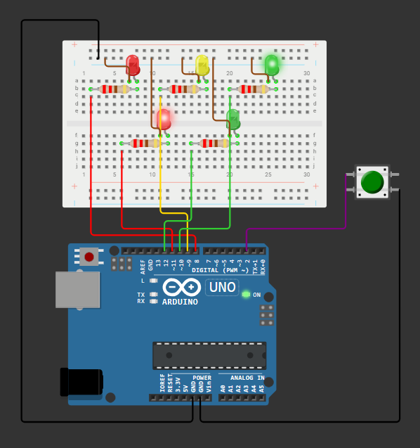
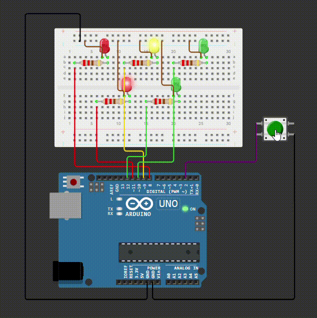

# Pedestrian Crossing

A traffic light with a pedestrian button. Cars have green until someone presses the button, then the lights run a safe crossing sequence.

## Components
- Arduino Uno
- 1x Red LED (cars)
- 1x Yellow LED (cars)
- 1x Green LED (cars)
- 1x Red LED (pedestrian)
- 1x Green LED (pedestrian)
- 5x 220 Ω resistors
- 1x Push button
- Breadboard
- Jumper Wires (Male to Male)

## Wiring

| Arduino | Connects to |
|---------|-------------|
| Pin 8 | 220 Ω resistor → Car Red LED long leg (anode, +) |
| Pin 9 | 220 Ω resistor → Car Yellow LED long leg (anode, +) |
| Pin 10 | 220 Ω resistor → Car Green LED long leg (anode, +) |
| Pin 11 | 220 Ω resistor → Pedestrian Red LED long leg (anode, +) |
| Pin 12 | 220 Ω resistor → Pedestrian Green LED long leg (anode, +) |
| Pin 2 | Push button, a leg on one side |
| GND | Push button, a leg on the **opposite side** |
| GND | All five LED short legs (cathode, −) |

## How It Works
- The sketch is a **state machine**. At any moment it is in exactly one of five states, and each state decides which LEDs are on and when to move to the next one.
- The sequence: `CARS_GREEN` → `CARS_YELLOW` → `CARS_RED` → `WALK` → `WALK_WARNING` → back to `CARS_GREEN`.
- Timing uses `millis()`. `enterState()` saves the time a state began, and `loop()` compares it with the current time. Nothing ever blocks, so the board can read the button at any moment.
- A press sets `requestPending = true`. The request is remembered even if it arrives mid-cycle, then handled when cars next have green.
- `MIN_GREEN_TIME` stops the lights from changing the instant the button is pressed, so cars always get a minimum green.
- `CARS_RED` is a 1-second all-red pause that gives the road time to clear before pedestrians walk.
- In `WALK_WARNING` the pedestrian green blinks, using `(elapsed / BLINK_INTERVAL) % 2` to switch it on and off without `delay()`.
- `setLights()` sets all five LEDs in one call, so the state logic stays easy to read.

**Why not `delay()`?** With `delay()`, a button press during the 5-second walk phase would be ignored because the board can't read the pin while it waits. A state machine with `millis()` checks the button on every pass through `loop()`.

## Demo

<b>Wokwi Link :</b> <a href = "https://wokwi.com/projects/479316336008217601">Pedestrian Crossing</a>
